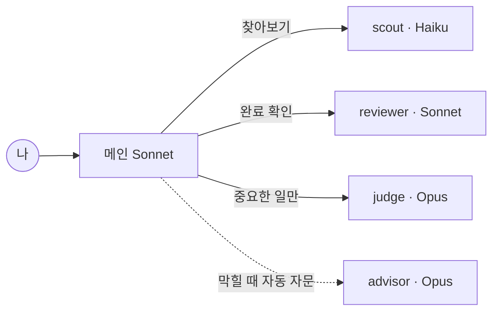

# pro-agent

[](https://github.com/joymin5655/pro-agent/actions/workflows/ci.yml)
[](LICENSE)

Claude Pro 요금제로 쓰는 개인 에이전트 키트입니다. Sonnet이 일하고, Haiku가 찾고, Opus가 결재합니다.

A personal agent kit for the Claude Pro plan. Sonnet does the work, Haiku looks things up, and Opus signs off only on important decisions.

## 누구를 위한 키트인가요

- Pro 구독으로 Claude Code나 Cowork를 쓰는 분
- 개발자가 아니어도 됩니다. 쓰는 말은 "계획 세워줘", "다 됐는지 확인해줘" 정도입니다.
- Max 요금제에서도 같은 방식으로 동작합니다.

## 왜 필요한가요

Claude Code의 기본 모델은 요금제마다 다릅니다. 공식 문서에는 이렇게 적혀 있습니다.

> Pro, Max, Ultra, Team, Enterprise, and Anthropic API: defaults to Opus 5.5

출처: [Default model setting](https://code.claude.com/docs/en/model-config#default-model-setting)

그런데 오류 안내에는 이런 항목도 있습니다.

> Claude Opus is not available with the Claude Pro plan.

출처: [Errors](https://code.claude.com/docs/en/errors#claude-opus-is-not-available-with-the-claude-pro-plan)

두 문서가 서로 맞지 않고, 만든 사람에게는 시험해 볼 Pro 계정이 없어 실제로 어떤지 확인하지 못했습니다. 그래서 이 키트는 메인 모델을 Sonnet으로 고정하고 Opus가 안 될 때는 Sonnet이 대신 판정하게 만들었습니다. 내 계정에서 Opus가 되는지는 설치 뒤 `/pro-agent:setup`의 연결 시험으로 확인할 수 있습니다.

Opus는 결정이 필요한 순간에만 씁니다. 자문 기능(advisor) 문서는 이렇게 설명합니다.

- "Sonnet main + Opus advisor" 조합은 "Sonnet handles routine work and escalates planning, ambiguous failures, and completion checks to Opus"입니다.
- "pairing a faster main model with a stronger advisor typically costs less than running the stronger model throughout"입니다.

출처: [Advisor](https://code.claude.com/docs/en/advisor)

## 구조



| 역할 | 모델 | 언제 | 설정 |
|---|---|---|---|
| 메인 | Sonnet | 평소 모든 대화 | 내가 `/model sonnet`을 칩니다 |
| scout (조수) | Haiku | 검색, 목록, 요약, 여러 질문 동시 조사 | 키트가 정해 둠 |
| reviewer (검토 담당) | Sonnet | 끝났다고 말하기 전 완료 확인 | 키트가 정해 둠 |
| judge (결재 담당) | Opus | 중요한 일의 계획 승인, 큰 결정, 최종 판정 | 키트가 정해 둠 |
| advisor (자문) | Opus | 계획이 막히거나 애매할 때 Sonnet이 자동으로 묻습니다 | 내가 `/advisor opus`를 칩니다 |

### "중요한 일"의 기준

아래 다섯 가지 중 하나에 해당할 때만 judge를 부릅니다.

- 되돌리기 어렵습니다 (삭제, 덮어쓰기, 배포, 기록 되감기)
- 바깥으로 나갑니다 (메일·메시지 전송, 게시, 공개)
- 돈이 듭니다
- 큽니다 (파일 10개 이상 또는 1시간 이상)
- 내가 중요하다고 말했습니다

judge는 계획 승인, 큰 결정, 최종 판정에만 부릅니다. 그 밖의 일에는 부르지 않습니다.
Opus를 쓸 수 없는 계정이면 같은 요청을 Sonnet으로 다시 보내고 판정 앞에 "(Opus 대신 Sonnet 판정)"을 붙입니다.

## 설치 (3분)

### 0) 준비

아래 설치 한 줄은 Claude Code 2.1.275 이상에서 됩니다. 버전은 `claude --version`으로 보고 낮으면 `claude update`로 올리거나 아래의 두 단계 방법을 쓰세요.
처음이라면 [빠른 시작](https://code.claude.com/docs/en/quickstart)이나 [데스크톱 앱 빠른 시작](https://code.claude.com/docs/en/desktop-quickstart)을 먼저 보세요.

### 1) 설치 한 줄

Claude Code 대화창에서 입력합니다.

```
/plugin install pro-agent --marketplace joymin5655/pro-agent
```

`/plugin` 패널이 열리면 내용을 확인하고 설치 범위를 고릅니다. "user"를 권합니다.

터미널에서 바로 설치할 수도 있습니다 (2.1.292 이상).

```
claude plugin install pro-agent --marketplace joymin5655/pro-agent
```

더 낮은 버전에서는 두 단계로 합니다.

```
/plugin marketplace add joymin5655/pro-agent
/plugin install pro-agent@pro-agent
```

### 2) 꼭 칠 두 줄

```
/model sonnet
/advisor opus
```

플러그인은 모델과 자문 설정을 바꿀 수 없습니다. 공식 문서에 "Only `agent` and `subagentStatusLine` take effect"라고 적혀 있습니다([Plugins reference](https://code.claude.com/docs/en/plugins-reference)). 그래서 두 줄은 직접 쳐야 합니다.
두 명령은 선택을 사용자 설정에 저장하므로 새 대화에서도 이어집니다([Model config](https://code.claude.com/docs/en/model-config), [Advisor](https://code.claude.com/docs/en/advisor)).

### 3) 점검

```
/pro-agent:setup
```

모델 설정을 읽어 보고 필요하면 바꿀 방법을 알려 줍니다. 원하면 Opus 연결 시험도 합니다. 시험은 Opus를 조금 쓰므로 먼저 물어봅니다.

### 4) claude.ai, 데스크톱 앱 채팅, Cowork에서 설치

Customize > Plugins → Add → Add marketplace → `joymin5655/pro-agent` 입력 → pro-agent 선택 → Add 순서입니다.
플러그인은 계정에 저장됩니다. 같은 계정으로 로그인한 Claude Code는 다음 세션을 시작할 때 이 플러그인을 동기화해 내려받습니다. 그 세션에서 `/reload-plugins`를 치거나 Claude Code를 다시 시작하면 불러옵니다.
끄거나 지우려면 Customize > Plugins에서 합니다. 출처가 믿을 만한 플러그인만 추가하세요. URL로 추가한 장터(marketplace) 플러그인은 Anthropic이 검토하지 않는다고 안내 페이지에 적혀 있습니다.
출처: [Plugins overview](https://claude.com/docs/plugins/overview)

어디서 무엇이 동작하는지 아래 표로 정리했습니다.

| 기능 | Claude Code | Cowork | 일반 채팅 |
|---|---|---|---|
| 스킬(plan, do 등 9개) | 동작 | 동작 | 동작 |
| PDF 노트 넣기·묻기(pdf, ask) | 동작 | 동작(직접 시험 못 함) | 쓸 수 없음 — 일반 채팅은 파일을 저장할 수 없습니다 |
| 보조 AI(scout, reviewer, judge) | 동작 | 동작 | 없음 |
| 세션 시작 규칙, 위험 명령 차단 | 동작 | 동작 | 없음 |

일반 채팅에서는 스킬만 동작하고, 파일을 읽고 쓰는 pdf와 ask는 쓸 수 없습니다(일반 채팅이 파일을 저장하지 못한다는 점은 공식 안내서에서 문장으로 직접 확인하지 못했습니다). Cowork는 공식 안내만 확인했고 직접 시험하지는 않았습니다.

### 5) 클라우드 세션은 안 됩니다

claude.ai/code 같은 클라우드 세션은 내 컴퓨터에 설치한 플러그인을 불러오지 않습니다. 같은 컴퓨터의 터미널, 데스크톱 앱 로컬 세션, VS Code 확장은 설정을 함께 읽으므로, 한 곳에 user 범위로 설치하면 다른 곳에도 나타납니다.
출처: [Install plugins](https://code.claude.com/docs/en/plugins/install)

## 이렇게 쓰세요

| 이렇게 말하면 | 하는 일 | 직접 부르기 |
|---|---|---|
| "계획 세워줘", "어떻게 진행할지 정리해줘" | 목표·성공 기준·단계·위험을 계획서로 만듭니다. 중요한 일이면 judge 승인까지 받습니다 | `/pro-agent:plan` |
| "계획대로 진행해줘", "이어서 해줘" | 계획의 첫 미완료 단계부터 실행하고 증거를 남깁니다 | `/pro-agent:do` |
| "다 됐는지 확인해줘", "빠진 거 없어?" | 성공 기준과 증거로 끝났는지 확인합니다 | `/pro-agent:check` |
| "A랑 B 중 뭐가 나아?", "결정 도와줘" | 선택지를 표로 비교해 추천 순서로 묻습니다. 중요한 결정이면 judge 의견도 받습니다 | `/pro-agent:decide` |
| "○○ 조사해줘", "비교해서 정리해줘" | 질문을 나눠 scout가 동시에 조사하고 출처를 붙여 종합합니다 | `/pro-agent:research` |
| "여기까지 기록해줘", "오늘은 여기까지" | 진행 상황을 파일에 남깁니다 | `/pro-agent:save` |
| "이 PDF를 옵시디언에 넣어줘" | PDF를 쪽 번호가 붙은 노트로 바꿔 노트 저장소에 넣고, 원본 PDF도 복사합니다 | `/pro-agent:pdf` |
| "내 노트에서 ○○ 찾아줘" | 노트에서 낱말로 찾아 노트 이름과 원본 PDF 쪽 링크를 붙여 답합니다 | `/pro-agent:ask` |
| (직접 실행만 가능) | 처음 설정을 점검합니다 | `/pro-agent:setup` |

기본 흐름은 계획 → 실행 → 확인 → 저장입니다.
메모는 프로젝트 폴더의 `agent-notes/PLAN.md`(계획)와 `agent-notes/PROGRESS.md`(진행 메모)에 남습니다.
다음에 그 폴더에서 Claude를 열면 "이어서 할 일"을 먼저 알려 줍니다.

## PDF를 옵시디언 노트로

`pdf`는 PDF를 노트 저장소에 마크다운 노트로 넣고, `ask`는 그 노트에서 찾아 근거와 함께 답합니다. 옵시디언이 없어도 마크다운 폴더면 됩니다.

**하는 일**
- 노트는 `PDF/<이름>.md`, 원본 PDF는 `PDF/원본/<이름>.pdf`에 넣습니다(다른 폴더를 말하면 그곳). 같은 이름이 있으면 덮어쓰지 않고 `-2`처럼 번호를 붙입니다. 원본이 이미 저장소 안에 있으면 복사하지 않고 그 파일에 링크합니다.
- 노트 맨 위에는 title, source, pages, converted, converter, tags 정보가 들어갑니다.
- 각 쪽은 `<!-- p.12 --> [[PDF/원본/파일.pdf#page=12|p.12]]` 줄로 시작합니다. 앞쪽은 `ask`가 쪽 번호를 찾는 표시이고, 뒤쪽은 원본 PDF의 그 쪽이 바로 열리는 옵시디언 링크입니다. 쪽 링크 `[[My file.pdf#page=3]]`와 끼워 넣기 `![[Document.pdf#page=3]]` 문법은 [옵시디언 도움말 저장소](https://github.com/obsidianmd/obsidian-help)의 `Release notes/v0.10.8.md`와 `en/Linking notes and files/Embed files.md`에 있습니다(옵시디언 앱에서 직접 눌러 보지는 못했습니다. 확인 못 함). 파일 이름에 `#`, `|`, `[`, `]`, `^`가 있으면 링크가 깨지므로 복사본 이름만 안전하게 바꿉니다.
- 글자 층이 없는 쪽(스캔)은 내용이 비므로 알려 드립니다. 원하면 그 쪽만 Claude가 읽어 채웁니다.
- `ask`는 질문을 낱말 묶음 2~5개로 나눠 scout가 동시에 찾게 합니다(노트가 몇 개뿐이면 직접 찾습니다). 뜻 검색(임베딩)과 별도 검색 목록은 쓰지 않는 낱말 검색입니다. 노트에 없으면 지어내지 않고 "노트에서 못 찾음"과 찾아본 낱말을 알립니다.

**추천 변환 도구: opendataloader-pdf** (Apache-2.0, Java 11 이상 필요). 같은 PDF 두 개로 2026-11-07에 만든 사람의 맥(macOS)에서 비교했습니다. 한글 보고서 59쪽과 파워포인트 강의 193쪽이고, 시간은 한 번 잰 값입니다.

| 도구(판, 라이선스) | 59쪽 시간 | 제목 수 | 쪽 표시 | 띄어쓰기 없이 12자 넘게 붙은 한글 덩어리(보고서/강의) |
|---|---|---|---|---|
| opendataloader-pdf 2.5.20 (Apache-2.0) | 3.5초 | 172 | 59/59 (옵션 제공) | 5 / 2 |
| pymupdf4llm 2.1 (AGPL-3.0) | 8.5초 | 114 | 스크립트로 붙여야 함 | 39 / 523 |
| markitdown 0.1.7 (MIT) | 6.0초 | 0 | 없음 | 8 / 132 |

docling, marker, MinerU는 기본 설치에 torch 같은 AI 모델 묶음이 필수라(PyPI 의존성으로 확인) 비개발자용으로는 뺐습니다. 한계: 비교는 문서 2개로만 했고, 표·그림의 품질은 숫자로 재지 않았으며, 그림 속 글자를 읽는 기능(OCR)은 쓰지 않습니다. 스캔 PDF는 비어 나옵니다.

**설치 (선택)**
변환 도구는 파이썬 3.11 이상이 필요한데(PyPI `requires_python >=3.11`) macOS 기본 파이썬은 3.9라, 파이썬을 알아서 받아 오는 uv로 설치합니다.
- macOS(Homebrew): `brew install openjdk uv`, `uv tool install opendataloader-pdf` (Homebrew의 openjdk는 PATH에 안 잡혀도 키트가 알려진 위치에서 찾습니다. 설치 뒤 명령을 못 찾으면 `uv tool update-shell`을 실행하고 새 터미널 창을 엽니다)
- Homebrew가 없는 macOS: Java는 [Adoptium 설치 파일](https://adoptium.net), uv는 [공식 설치 안내](https://docs.astral.sh/uv/)를 따릅니다. 그다음 `uv tool install opendataloader-pdf`
- Windows: `winget install EclipseAdoptium.Temurin.21.JDK`, `winget install astral-sh.uv`, `uv tool install opendataloader-pdf` (Windows에서는 직접 시험하지 못했습니다. 확인 못 함)
- PATH가 아직 안 잡혀도 키트는 `~/.local/bin`(uv·pipx 기본 설치 위치)에서 도구를 찾습니다.
- 설치는 키트가 하지 않습니다. 준비됐는지는 `/pro-agent:setup`이 알려 줍니다.

**도구가 없으면**: 그 자리에서 위 설치를 권합니다. 원하지 않으면 Claude가 PDF를 직접 읽어 같은 형식의 노트로 옮깁니다. 30쪽을 넘으면 사용량을 먼저 알리고 묻습니다. 한 번에 10개 이상 넣을 때는 plan과 judge 승인을 먼저 권합니다.

**데이터 흐름**
- 변환 도구로 바꿀 때: PDF는 내 컴퓨터 안에서만 처리하고, 키트는 PDF를 밖으로 보내지 않습니다(도구 자체의 네트워크 사용을 따로 측정하지는 못했습니다. 확인 못 함).
- Claude가 직접 읽을 때: PDF 내용이 대화로 Claude에 전달됩니다.
- `ask`: 찾은 노트 부분은 대화로 Claude에 전달되고, scout가 찾을 때는 Haiku가 읽습니다.

## Pro 한도 아끼기

- `/usage`로 남은 사용량을 자주 봅니다. ([비용 관리](https://code.claude.com/docs/en/costs))
- 주제가 바뀌면 `/clear`로 새로 시작합니다.
- Opus는 judge와 advisor에만 씁니다.
- Fable 모델로는 바꾸지 않습니다. 문서에 "Fable usage can bill to usage credits"라고 되어 있습니다([Fable and usage credits](https://code.claude.com/docs/en/model-config#fable-and-usage-credits)). 키트도 허락 없이는 바꾸지 않습니다.
- 자문(advisor) 사용량도 요금제 한도에 포함됩니다. 보조 AI는 설정된 자문을 물려받습니다. 문서 표현은 "advisor usage counts toward your plan's usage limits"와 "Subagents inherit the configured advisor"입니다.
- 한도가 가까우면 "여기까지 기록해줘"라고 말하고 쉬세요. 추가 사용량을 사라고 권하지는 않습니다.

## 자주 묻는 것

**"Claude Opus is not available with the Claude Pro plan." 오류가 나요.**\
judge는 자동으로 Sonnet으로 다시 시도합니다. 자문은 `/advisor sonnet`이나 `/advisor off`로 바꾸세요. 메인 모델이 문제라면 `/model sonnet`을 입력합니다.
참고로 API가 자문 조합을 거부하면 Claude Code는 자문 없이 그 요청을 다시 보내고 조용히 이어 갑니다. 자문이 꺼진 것 같으면 `/advisor`만 쳐서 현재 자문을 확인하세요.

**큰 계획만 Opus로 하고 싶어요.**\
`opusplan` 설정이 있습니다. 계획 모드에서는 `opus`, 실행에서는 `sonnet`을 씁니다. 키트의 기본값은 아니고 Opus를 쓸 수 있어야 합니다. ([opusplan](https://code.claude.com/docs/en/model-config#opusplan-model-setting))

**업데이트, 끄기, 지우기는요?**\
Claude Code에서는 `/plugin`의 Installed 탭에서 켜고 끄고 업데이트하고 지울 수 있습니다. 터미널은 `claude plugin update pro-agent@pro-agent`(다시 시작해야 적용), `claude plugin uninstall pro-agent@pro-agent`입니다. 대화 중 바로 반영하려면 `/reload-plugins`를 씁니다. 데스크톱 앱의 Code 탭은 프롬프트 상자 옆 `+` → Add plugins(또는 Plugins → Manage plugins)에서 합니다. 채팅·Cowork는 Customize > Plugins입니다.

**채팅, Cowork, 클라우드 세션에서는요?**\
채팅은 스킬만, Cowork는 스킬·명령·보조 AI·자동 점검 장치(hook)까지, 클라우드 세션은 아무것도 불러오지 않습니다. 위 설치 4)와 5)를 보세요.

**막힌 명령을 꼭 실행해야 하면요?**\
명령을 확인한 뒤 내 터미널에서 직접 실행하세요. 자세한 내용은 [docs/safety.md](docs/safety.md)에 있습니다.

**내 데이터는 어디에 있나요?**\
계획과 진행 메모는 프로젝트의 `agent-notes` 폴더에만 저장됩니다. PDF 노트와 원본 복사본은 내가 고른 노트 저장소 폴더(기본 `PDF/`)에 저장됩니다. 키트의 자동 점검 장치는 아무것도 밖으로 보내지 않습니다. 다만 조사(research)를 맡기면 scout가 웹 검색을 하고, Claude가 PDF를 직접 읽거나 `ask`로 노트를 읽으면 그 내용이 대화로 Claude에 전달됩니다. 변환 도구로 바꾸는 동안 키트는 PDF를 밖으로 보내지 않습니다(도구 자체의 네트워크 사용은 따로 재지 못했습니다).

## 추천 유튜브 채널

제가 챙겨 보는 채널들인데, Claude와 AI로 일하는 법을 더 알고 싶다면 이 세 곳을 추천합니다. 위에서부터 보시면 됩니다.

1. **[양실장의 바이브코딩대학](https://www.youtube.com/@VibecodingUniversity)**\
   처음이라면 여기부터입니다. 비개발자 눈높이에서 바이브코딩 기초부터 회사 업무에 AI를 들이는 방법(AX)까지 다루는데, 기술 배경이 없어도 따라가기 좋습니다.
2. **[실밸개발자](https://www.youtube.com/@sv.developer)**\
   Claude Code를 제대로 써 보고 싶어지면 이 채널입니다. 입문부터 심화까지 묶은 통합 강의가 있고, Cowork 가이드랑 하네스 세팅 영상도 있습니다. 일하는 방식 자체를 다룬 "AI를 기존 방식에 얹지 마세요" 영상도 같이 보시면 좋습니다.
3. **[커리어해커 알렉스](https://www.youtube.com/@careerhackeralex)**\
   AI로 일하는 방식을 아예 바꿔 보고 싶을 때 봅니다. "AI 처음이라면, 설치 없이 말로 시작하는 첫 30분"이나 비개발자를 위한 AI 구독료 기준 같은 영상이 있습니다. 실밸개발자와 함께한 AI 토크도 있어서 2번 채널과 이어서 보기 좋습니다.

## 만든 사람의 꿀팁

이 키트를 만들면서 직접 겪은 것들인데, 그냥 넘기기 아까운 것만 추렸습니다.

1. **보조 AI를 부를 때는 모델을 꼭 적으세요.** 안 적으면 메인 모델을 그대로 물려받습니다. 제 작업 기록을 확인해 보니 맡긴 일 7건이 전부 가장 비싼 모델로 돌고 있었습니다.
2. **작은 일은 맡기지 마세요.** 맡기는 것도, 결과를 보고받는 것도 다 사용량이라서 파일 한두 개 읽는 정도는 직접 하는 편이 쌉니다.
3. **꼭 지켜야 하는 규칙은 글로만 두지 말고 자동 점검 장치(hook)로 만드세요.** 비밀값 검사 설정 파일까지 만들어 뒀는데, 정작 검사는 한 번도 돌지 않던 저장소를 한참 뒤에 발견했습니다. 글로 적은 규칙은 그냥 부탁입니다.
4. **"다 됐어요"는 실행 결과로 받으세요.** 확인하지 못한 건 "확인 못 함"이라고 쓰게 해야 합니다. 이 키트의 check가 그 일을 합니다.
5. **한도에 닿기 전에 진행 메모부터 남기세요.** 대화는 끊겨도 파일은 남습니다. 메모만 있으면 다음 세션에서 바로 이어서 할 수 있습니다.
6. **결정은 선택지와 추천으로 받으세요.** "어떻게 할까요?"라고 열어 두면 오히려 헷갈리는데, "A(추천), B, C 중 고르세요"로 받으면 훨씬 빨리 정해집니다.
7. **절약 도구의 홍보 숫자는 직접 재 보세요.** 제가 쓰던 사용량 절약 도구도 내세우는 숫자는 컸는데, 실제로 재 보니 2% 안팎이었습니다.

## 참고한 프로젝트

| 프로젝트 | 별 | 가져온 생각 |
|---|---|---|
| [obra/superpowers](https://github.com/obra/superpowers) | 31.3만 | 질문 → 계획 → 작업마다 새 보조 AI로 실행하고 검토하는 흐름, 보조 AI를 부를 때 모델을 적는 습관 |
| [affaan-m/ECC](https://github.com/affaan-m/ECC) | 29.8만 | 보조 AI·스킬·자동 점검 장치·규칙을 폴더로 나눠 담는 구성 |
| [multica-ai/andrej-karpathy-skills](https://github.com/multica-ai/andrej-karpathy-skills) | 23만 | 생각 먼저·단순하게·필요한 곳만·확인 가능한 목표, 네 가지 원칙 |
| [shanraisshan/claude-code-best-practice](https://github.com/shanraisshan/claude-code-best-practice) | 6.9만 | 보조 AI·명령·스킬 같은 공식 기능을 쓰는 모범 사례 |
| [gsd-build/get-shit-done](https://github.com/gsd-build/get-shit-done) (지금은 [open-gsd/gsd-core](https://github.com/open-gsd/gsd-core)) | 6.4만 | 진행 상태를 파일로 남겨 세션이 끊겨도 이어 가는 방식, 끝내기 전 확인 단계 |
| [wshobson/agents](https://github.com/wshobson/agents) | 4.2만 | 보조 AI마다 모델(opus·sonnet·haiku)을 정해 두는 방식 |
| [Yeachan-Heo/oh-my-claudecode](https://github.com/Yeachan-Heo/oh-my-claudecode) | 4.1만 | 쉬운 일은 Haiku, 복잡한 추론은 Opus로 나누는 모델 배분 |

별 수는 2026-11-06에 GitHub API로 확인했습니다. 코드나 글을 복사하지 않고 생각만 빌렸습니다.

## 개발자용

```
.claude-plugin/   plugin.json, marketplace.json
agents/           scout, reviewer, judge
skills/           plan, do, check, decide, research, save, pdf, ask, setup (pdf/pdf-to-note.sh = PDF 변환 스크립트)
rules/            operating-rules.md (세션 시작 때 주입)
hooks/            hooks.json, session-start.sh, guard-bash.sh
tests/            test-guard-bash.sh, test-session-start.sh, test-pdf-to-note.sh, validate-structure.py (fixtures/ = 시험용 PDF)
evals/            스킬 발동 시험 9건
docs/             how-it-works.md, safety.md
.github/          workflows/ci.yml
```

시험 실행:

```
bash tests/test-guard-bash.sh
bash tests/test-session-start.sh
bash tests/test-pdf-to-note.sh
python3 tests/validate-structure.py
claude plugin validate --strict .
```

스킬이 제때 발동하는지 보는 평가는 `claude plugin eval .`으로 돌립니다. 사례는 `evals/` 폴더에 있습니다.

더 읽을 것: [docs/how-it-works.md](docs/how-it-works.md), [docs/safety.md](docs/safety.md), [CHANGELOG.md](CHANGELOG.md)

## 라이선스

MIT입니다. [LICENSE](LICENSE)를 보세요.
